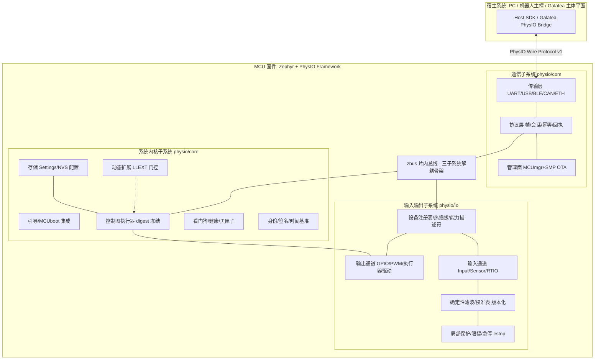

# PhysIO 子项目初步调研与功能范围（RESEARCH_01）

> 版本：v0.1 · 2026-09-15 · 状态：DRAFT（待 owner 裁决 Q-PIO-01…10）
> 定位：PhysIO = 基于 Zephyr RTOS 的 MCU 末端输入输出框架。目标：让单片机成为各种系统/机器人的**末端 I/O 模块**，支持动态编程与固件更新，输入/输出设备可插拔替换。
> 双重身份：① Galatea P1 物理具身的固件端（须满足 `design/lld/L10` §4.6 PhysIO 合同）；② **独立可复用模块**（其他项目可直接引用，Galatea 专属逻辑只放 `app/galatea_node/`，不进核心）。

> ⚠️ **本文档有三处已被 owner review 质疑，但内容原样保留待裁决（2026-09-16）**：
> - **§3.2 通信子系统**：全节以"已决定"口吻描述自研 CBOR 帧线协议，但对应 Q-PIO-07 仍 UNCONFIRMED
>   ⇒ **文档内部矛盾**；协议选型调研与五层分层模型见 `RESEARCH_02_comm_protocol.md`；
>   候选与裁决提案已拟为 **Q-PIO-07a…07e**，本文档 §6 的 Q-PIO-07 行**待裁决后一次性改写**。
> - **§4 第 2 条负清单**（"不做通用机器人中间件（无 ROS/DDS/zbus 之外的对外中间件）"）：
>   谓词歧义（不自研 vs 不引入）、层次混淆（把片内总线 zbus 与对外中间件并列）、适用域未界定（见 **Q-PIO-11**）
>   ⇒ 三个修订变体 N2-a/N2-b/N2-c 见 `RESEARCH_02` §7.3。
> - **§4 第 4 条**（"不做多 MCU 组网路由"）：**与第 2 条暗中耦合**——Zenoh 的主要卖点之一就是组网路由，两条必须配套修订。
>
> ⇒ 裁决前不预先修改这三处，避免半成品文档互相矛盾（纪律见 `RESEARCH_02` §10 风险 R7）。
> 另：§5 里程碑 M0 的验收项"`module/` 空壳构建通过"目前无法执行——实现产物已于 2026-09-16 全部撤回，见 `RESEARCH_01_appendixA_contract_notes.md` §A.5。

---

## 1. Zephyr 平台调研结论

### 1.1 版本与支持（截至 2026-09-15 调研）

| 版本 | 发布 | 支持至 | 备注 |
|---|---|---|---|
| 4.4.0 | 2026-04-14 | 2027-04-12 | 当前 latest stable |
| 4.3.0 | 2025-11-14 | 2026-10-15 | stable |
| 3.7.0 (LTS3) | 2024-07-26 | 2029-07-27 | 现行 LTS，维护到 2029 |
| 4.5 | 计划 2026-10 | — | 下一个 stable |
| 4.6 (LTS4) | 计划 2027-04 | ~2032 | **下一个 LTS** |

- 发布节奏：每 6 个月一个 stable（4 月/10 月）；LTS 每 2.5–3 年，维护约 5 年。
- 1000+ 官方支持板卡；构建体系 west + CMake + Kconfig + Devicetree；硬件描述全部走 Devicetree（对我们"设备可插拔"极为有利：换设备 ≈ 换 overlay + 驱动绑定，不改框架代码）。
- **版本策略候选**（→ Q-PIO-01）：
  - A. 基于 **4.4/4.5** 开发，2027 年 LTS4 发布后迁移（获得新特性：LLEXT 更成熟、zbus proxy agent 等）；
  - B. 基于 **LTS3（3.7）** 求稳（但 LLEXT/zbus proxy 等新能力缺失或弱）。
  - 建议：**A**，锁定 4.5（2026-10 发布后即升），理由：本项目周期与 LTS4（2027-04）重叠，届时按官方 migration guide 平移；早期用 latest stable 拿新子系统。

### 1.2 可直接复用的 Zephyr 子系统（避免自研轮子）

| Zephyr 子系统 | 用途（对应本项目哪块） | 成熟度 |
|---|---|---|
| Device Driver Model + Devicetree | 设备抽象/可插拔的机制底座（IO 子系统） | 稳定（LTS API） |
| Input 子系统 | 输入设备事件模型（按键/轴/触摸/编码器，`input_event` + 回调） | 稳定 |
| Sensor API（100+ 驱动） | 传感器读取标准接口 | 稳定 |
| Sensing 子系统 | 传感器融合/多客户端/采样调度（虚拟传感器=融合链） | 较新，可选用 |
| RTIO（io_uring 风格） | 异步/DMA 批量 I/O，提交队列+完成队列（IO 子系统数据面） | 较新但核心样例齐 |
| zbus | 片内发布订阅总线（三大子系统解耦的通信骨架；支持运行时通道/观察者注册、proxy agent 跨核） | 稳定；proxy agent 实验性 |
| MCUmgr + SMP 协议 | 设备管理/固件上传/重启/镜像管理，传输支持 UART/UDP/BLE/shell（COM 子系统管理面） | 稳定 |
| MCUboot + DFU（flash_img/flash_map） | 签名镜像 A/B 槽升级、回滚（动态更新的地基） | 稳定 |
| LLEXT | **运行时装载 ELF 扩展**（动态编程第三层，见 §3.1） | 实验性；仅 RISC-V/ARM/ARM64/ARC/x86/Xtensa |
| SMF（状态机框架） | 控制图执行引擎的状态机底座候选 | 较新 |
| Settings / NVS / ZMS / retention | 参数与配置的持久化（动态配置层） | 稳定 |
| Shell | 调试/运维命令面 | 稳定 |
| Logging / Tracing / Task Watchdog | 可观测性与看门狗（内核子系统） | 稳定 |
| 网络协议栈 / Bluetooth / USB / CAN / Modbus / LoRaWAN | COM 子系统传输层选项 | 稳定 |
| Crypto / JWT / Authentication / TF-M | 镜像与命令签名、设备身份（内核子系统安全件） | 稳定（TF-M 限特定 SoC） |

**结论**：通信、OTA、设备模型、片内总线均有现成高质量子系统；本项目自研的核心是**其上的框架层**——设备注册/热插拔语义、能力描述符与清单、协议 schema（受 Galatea 认识链合同启发但独立可用）、控制图执行器、动态编程分层策略、局部保护/急停。

---

## 2. 总体架构（三大子系统 + 一薄层）

- 三子系统之间**只经 zbus 通道 + 定义好的 C API** 交互，禁止直接函数私链（可插拔的片内表达）。
- 与宿主的唯一边界是**协议层**（Wire Protocol v1）；Galatea 专属语义（ReceivedSignal/SubmittedCommand/ExecutionReceipt 映射）放在 `app/galatea_node/` 与宿主侧 Bridge，核心模块不 import 任何 Galatea 概念——这保证"未来单独用于其他项目"。

---

## 3. 功能清单（做什么 / 不做什么）

### 3.1 系统内核子系统（CORE）

**动态编程三层策略**（关键设计决策，逐层风险递增、逐层门控）：

| 层 | 机制 | 动态性 | 风险 | 版本 |
|---|---|---|---|---|
| D1 配置动态 | Settings/NVS/ZMS 参数（校准表、增益、滤波系数、保护阈值） | 重启或热生效 | 低 | **V1** |
| D2 图动态 | **控制图（Control Graph）**：数据驱动的有向图，节点=内置确定性算子库（限幅/滤波/映射/状态机/比较器…），边=数据流；图文件签名+digest 冻结后下发，固件内执行器解释执行 | 不刷固件改变控制行为 | 中（算子集封闭，行为有界） | **V1** |
| D3 代码动态 | LLEXT 运行时装载 ELF 扩展 | 任意新代码 | 高（实验性、无 MPU 隔离时与主镜像同权） | **V2，默认 Kconfig 关闭**，仅签名扩展可装载 |

- 控制图合同（与 Galatea L10 对齐但独立成立）：全图 digest 冻结、禁未签名加载、节点算子集封闭枚举、每算子参数范围显式声明、执行超时/预算、图失效→回退安全态。
- 引导与更新：MCUboot（签名验证、A/B 槽、防回滚计数）+ MCUmgr SMP（固件上传/确认/回滚/重启）+ 镜像元数据（版本、digest、构建时间、兼容协议版本）。
- 健康与恢复：Task Watchdog 每子系统喂狗；panic → retention 黑匣子（最近 N 事件环形记录）→ 自恢复或等待宿主复位指令；升级失败自动回滚。
- 时间基准：单调时钟（`k_uptime` 32/64 位）打边缘时间戳；与宿主时间对齐协议（请求-应答时延补偿）；**不引入 RTC 依赖**（→ Q-PIO-06 是否需要绝对时间戳）。
- 安全：设备唯一身份（烧录证书或 TF-M）；命令/图/镜像三重签名校验；SMP shell 默认关闭、授权开启。
- 资源治理：每子系统独立 workqueue/线程与栈预算；内存池静态分配为主（Kconfig 可调）；CPU 负载统计上报。

### 3.2 通信子系统（COM）

- **Wire Protocol v1**（自研，CBOR 编码——Zephyr 内置 tinycbor）：
  - 帧：magic/version/长度/CRC + payload；会话：握手协商（协议版本、设备清单摘要、能力集）；
  - 消息类：`DISCOVER` `HELLO/CAP` `STREAM_SUB/UNSUB` `CMD`（带 `command_id` + `idempotency_key` + deadline）`CMD_ACK/NACK` `EVENT` `TELEMETRY` `ESTOP` `MGMT`（复用 SMP 或旁路）；
  - **命令-回执分离**（借自 Galatea 但通用）：`CMD` → `ACK`（已接受）与 `RECEIPT`（已执行完/失败+错误码）两条独立消息；宿主可据此区分"没收到""没执行""执行失败"。
- 传输层抽象：V1 支持 **USB-CDC/UART**（调试与默认）+ **BLE**（无线形态）；V2 候选 Ethernet/UDP、CAN（机器人总线场景，→ Q-PIO-03）；传输可多路并存（管理面走一路、数据面走另一路）。
- 管理面直接复用 **MCUmgr/SMP**（OTA、重启、镜像查询、fs 操作、自定义 handler 挂设备注册表查询）。
- 流控与背压：订阅式流（采样率/批量/触发条件由宿主设定）；链路断开→IO 子系统进入预定义安全态（fail-safe profile）；重连后会话恢复（订阅表重建，幂等键去重）。
- 发现与配网：BLE 广播带设备类型/型号；USB 描述符自定义 vendor/product；设备序列号即身份。

### 3.3 输入输出子系统（IO）

- **设备注册表（Device Registry）**：
  - 每设备一份**能力描述符**（type/class/版本/量程/采样能力/digest），Devicetree 定义静态设备 + 运行时动态注册（热插拔）两路都进同一注册表；
  - 事件：`DEVICE_ADDED/REMOVED/FAULTED/REVALIDATED` 上 zbus + 上报宿主；设备更换 = 旧 digest 失效 + 新描述符注册（与 Galatea"设备新增/更换/隔离/重新纳入"流程同构）。
- **热插拔支持范围**（→ Q-PIO-04）：V1 支持 ① USB 设备（Zephyr USB host stack）② I2C/SPI 挂载设备探测（注册表指令触发扫描）③ GPIO 类即插即用；不支持原生总线级 surprise removal 的芯片差异由驱动层消化。
- **输入通道**：Zephyr Input 子系统（事件型：按键/编码器/触摸）+ Sensor API（读数型：IMU/温湿度/光…）+ 可选 Sensing 子系统（融合链）；统一封装为 `physio_stream`（带频率、时间戳、单位、量程元数据）；批量读取走 RTIO。
- **输出通道**：GPIO/PWM/DAC + 执行器驱动接口（舵机/步进/直流电机/继电器模板驱动）；每个输出通道显式声明**安全默认态**（上电、断链、故障三态各自的行为）。
- **信号调理链**（确定性、版本化）：原始读数 → 校准表（线性/分段/温度补偿，参数经 D1 下发）→ 确定性滤波（滑动均值/中值/一阶低通，禁浮点非确定路径，定点优先）→ 单位/量程归一 → 上报告。**同一输入必得同一输出**（重放测试可验）。
- **局部保护（L0 层）**：硬件比较器/GPIO 中断级急停（`estop_in`）；软件限幅（每输出通道 min/max/slew-rate）；看门狗超时→全输出安全态；保护动作**先于**任何上层逻辑（ISR/最高优先级线程），且产生强制 EVENT 上报。

### 3.4 Galatea 对接层（薄，位于 app/galatea_node + 宿主侧）

- 固件侧 `app/galatea_node/`：把 Wire Protocol v1 的事件映射为 Galatea `ReceivedSignal` 语义承载体、把下行 `CMD` 与 `SubmittedCommand/AuthorizationDecision` 校验对接；四类现实授权（functional_ability / enabled_interface / containment_allowance / deployment_authorization）在本层以只读配置落地。
- 宿主侧（未来在 `galatea/**` Python 端实现，不在本子项目内）：PhysIO Bridge。
- **本子项目核心不依赖 Galatea 任何类型**；此层可整体删除而框架完好（机械验证：CI 单独构建 `module/`）。

---

## 4. 明确不做（V1 负清单）

1. 不做片上学习/自适应控制（PhysIO 合同：非学习）；
2. 不做通用机器人中间件（无 ROS/DDS/zbus 之外的对外中间件）；
3. 不做文件系统级插件市场；D3 代码动态仅限签名 LLEXT；
4. 不做多 MCU 组网路由（V1 单 MCU 单宿主直连；多节点编队 → V2 议题）;
5. 不复刻 SMP/MCUmgr 已有能力（管理面直接用）；
6. 不做 GUI/仪表盘（宿主侧工具最小化为 CLI + Python SDK）。

---

## 5. 里程碑（建议）

| 里程碑 | 内容 | 验收 |
|---|---|---|
| M0 bring-up | west 工作区 + `module/` 空壳在 native_sim 与 ≥1 真实板（→ Q-PIO-02）构建通过；shell/logging/zbus 骨架 | CI 双平台绿 |
| M1 COM v1 | Wire Protocol v1 over USB-CDC/UART：握手、DISCOVER、EVENT 上报、CMD/ACK/RECEIPT、断链安全态 | Python 宿主测试脚本全过 |
| M2 IO 核心 | 设备注册表 + ≥2 输入类（GPIO 按键、I2C 传感器）+ ≥2 输出类（GPIO、PWM 舵机）+ 校准/滤波链 + 重放一致性测试 | 同输入同输出验证 |
| M3 保护与 OTA | estop 链路（硬件+软件）；MCUboot+SMP 签名升级、回滚、断电续传 | 升级失败自动回滚演练 |
| M4 图动态 | 控制图 schema + 执行器 + 签名/digest 校验 + ≥3 个示例图 | 未签名图拒载；图切换不重启 |
| M5 Galatea 对接 | `app/galatea_node/` 映射层 + 宿主 Bridge（Python，另一仓库/目录） | 与 Galatea P1 stub 联调 |
| V2+ | LLEXT 门控开启、BLE/以太网/CAN 传输、Sensing 融合链、多节点 | — |

## 6. 未决问题（→ 待 owner 裁决，格式对齐 open_questions.md）

| Q 号 | 议题 | 建议默认 | 依赖 | 状态 |
|---|---|---|---|---|
| Q-PIO-01 | Zephyr 版本基线 | 4.5（2026-10），LTS4 后迁移 | 全部 | UNCONFIRMED |
| Q-PIO-02 | 首选开发板/SoC 家族 | 双平台：native_sim（CI）+ nRF52840 DK（BLE/LLEXT/TF-M 全支持）；备选 STM32/RP2350/ESP32 | M0 | UNCONFIRMED |
| Q-PIO-03 | V1 传输集合 | USB-CDC + UART + BLE；CAN/以太网 V2 | M1 | UNCONFIRMED |
| Q-PIO-04 | 热插拔的 V1 支持边界 | USB 设备 + 总线扫描注册 + GPIO 类；不做 surprise removal 全覆盖 | M2 | UNCONFIRMED |
| Q-PIO-05 | D3 代码动态（LLEXT）是否进 V1 | 不进；V2 且默认关闭、仅签名 | M4/安全评审 | UNCONFIRMED |
| Q-PIO-06 | 时间戳精度与是否需绝对时间 | 单调时钟 µs + 宿主对齐协议；无 RTC 依赖 | M1 | UNCONFIRMED |
| Q-PIO-07 | Wire Protocol 编码 | CBOR（tinycbor）；备选 protobuf-nanopb | M1 | UNCONFIRMED |
| Q-PIO-08 | 项目许可证与仓库形态 | Apache-2.0；先 in-tree `physio/`，首次外部复用前拆独立仓库 | — | UNCONFIRMED |
| Q-PIO-09 | 控制图算子集封闭清单 | V1：limit/scale/filter/sm/state_machine/compare/mux/delay/estop_hook（≤12 个） | M4 | UNCONFIRMED |
| Q-PIO-10 | 宿主侧 Python SDK 放哪 | `physio/host/`（同仓库 tools 级）与 Galatea Bridge 分离 | M1/M5 | UNCONFIRMED |

---

## 7. 关键风险

1. **LLEXT 成熟度**：官方标注需架构支持且仍在演进——已通过"D3 延后 + 默认关闭"处置；
2. **Flash/RAM 预算**：协议栈 + BLE + MCUboot 双槽对 <256KB flash 芯片紧张——目标 SoC 下限建议 512KB flash / 128KB RAM（Q-PIO-02 关联）；
3. **Zephyr API 漂移**：非 LTS 期 API 会变（如 pipes v2、message queues v2 并存）——锁版本 + 每半年一次受控升级评估；
4. **热插拔语义碎片化**：各总线驱动对拔插行为支持不一——注册表统一事件语义，差异下沉驱动适配器；
5. **与 Galatea 合同双写风险**：Wire Protocol 与 Galatea L10 合同各自演进可能漂移——对接层单一映射点 + M5 联调回归。
