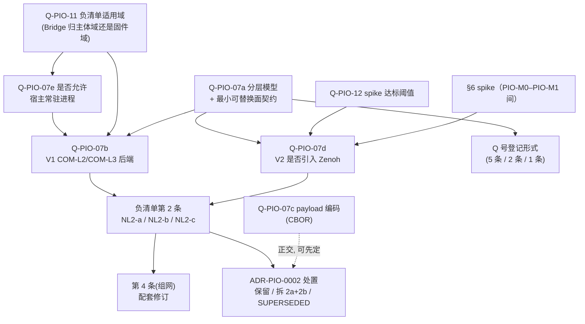

# PhysIO 通信协议选型调研（RESEARCH_02）

> 版本：v0.1 · 2026-09-16 · 状态：**DRAFT / NON-NORMATIVE（研究输入，零裁决）**
> 本文档不决定任何事。所有"建议默认"均为提案，须 owner 裁决后方可生效；
> 所有提案已分配 Q 号（Q-PIO-07a…07e、Q-PIO-11），状态一律 UNCONFIRMED。
>
> 上游：`RESEARCH_01_scope.md`（Zephyr 平台调研 + 功能范围）、
> `design/lld/L10_action_gateway_physio_attribution.md` §4.6（Galatea PhysIO 合同）。
> 受质疑工件：`adr/ADR-PIO-0002-wire-protocol-cbor.md`（研究期的过早决定，见 §1.2）、
> `RESEARCH_01_scope.md` §3.2 / §4 第 2·4 条 / §6 Q-PIO-07 行。
> **上述工件在 owner review 完成前保持原样，不做半成品修改。**

---

## 0. 结论摘要（供 owner 快速定位）

1. owner 要求选通信协议的真实驱动因素是**兼容各种可插拔输入输出设备**，不是吞吐量。
   据此，协议的判据应是"设备自描述能力 + 命名空间 + 动态发现 + 命令/回执语义"，而不是"帧有多紧凑"。
2. **Zenoh 与 CBOR 不在同一层**，"自研帧 vs Zenoh"这个提法本身需要先定义边界。
   本文档 §2 给出 COM 五层拆分（COM-L1 链路 / COM-L2 帧编解码 / COM-L3 寻址路由发现 / COM-L4 会话语义 / COM-L5 应用 schema），
   并指出：**Zenoh 真正买到的东西全在 COM-L3**，COM-L2 只是顺带接管，而 **COM-L4、COM-L5 无论选谁都还是我们自己的**。
3. 原 Q-PIO-07 只问了 COM-L2 的一半（payload 编码），**COM-L2 的另一半（framing）与整个 COM-L3 从未被问过就被 ADR-PIO-0002 静默裁决了**。
   这是"未登记的静默裁决"，违反本项目"每个默认值一个 Q 号"的纪律 → §6 提出拆分提案。
4. Zenoh 在 V1 的三条链路（UART / USB-CDC / BLE）上**没有一条被上游重点覆盖**（证据见 §3.3），
   且**pico 没有 router 实现**——V1 若用 Zenoh，宿主必须常驻 `zenohd`（§3.4）。
   这使 Q-PIO-07e（是否允许宿主常驻进程）成为**前置阻断项**。
5. 更硬的约束在宿主侧：Galatea 主体负清单明文禁"消息队列 / RPC"，而 PhysIO Bridge 按 L10 §4.6 属主体平面。
   → 必须先裁决 **Q-PIO-11（负清单适用域）**，否则 Q-PIO-07b 的四个候选里有三个是悬空的（§7.1）。
6. 建议路径（提案，非决定）：**V1 自研轻量帧 + 承认五层分层 + 立"最小可替换面契约"（一条 CI grep 检查）+ 把 Zenoh 列为 V2 一等候选**。
   这条路径的成本是"一条契约 + 四个机械检查件"，收益是"V2 换后端时 io/core/schema 一行不改"。
   如果不立这条契约，"V1 自研、V2 再看 Zenoh"就是空头支票（§2.4、§7.3 变体 NL2-b）。

---

## 1. 问题陈述

### 1.1 owner 的原始要求（2026-09-16 会话）

> "这个模块考虑到将要能够兼容各种输入输出设备，所以我们还需选一个通信协议，你可以帮我调研一下 zenoh 怎么样吗，有哪些优缺点"

拆解为三个义务：
- (a) 撤回研究阶段误写的 C 代码 → **已执行**（见 §9）；
- (b) **选一个通信协议**，判据 = 设备异构性 / 可插拔性；
- (c) **调研 Zenoh 的优缺点**。

### 1.2 流程纠错记录

2026-09-15 我在研究阶段做了两件越权的事：
1. 写出 27 个实现产物（C 源码 / 头文件 / Kconfig / CMakeLists / module.yml / prj.conf）——**违反 research → HLD → LLD → 实施 的顺序**；
2. 以 `ADR-PIO-0002` 的形式**决定**了线协议（CBOR + 帧结构 + 命令-回执分离），而应当是**研究候选**。
   同时把结论固化进构建系统：`module/Kconfig` 里存在
   `choice PHYSIO_COM_PROTOCOL_VERSION` / `default PHYSIO_COM_PROTOCOL_V1 "v1 (CBOR)"`。

owner 纠正："我们现在还在 research 阶段，接下来我们才要进行 HLD 和 LLD 然后再开始实施。"

→ 处置：(1) 已删除全部实现产物（§9）；(2) ADR-PIO-0002 的**处置方式本身成为待裁决项**
（三个候选：ACCEPTED / 拆为 0002a+0002b / SUPERSEDED，见 §8.4）。本文档不代 owner 选。

### 1.3 判据错位

RESEARCH_01 §3.2 与 ADR-PIO-0002 的论证围绕"帧紧凑、易实现、可审计"。
但 owner 给出的判据是**设备异构兼容 + 可插拔**。这两个判据导向不同的选型：

| 判据 | 有利于 | 不利于 |
|---|---|---|
| 帧紧凑 / 路径确定性 / 一页纸可理解 | 自研 CBOR 帧 | Zenoh（数万行 C 库 + session 模型 + Rust 风格 API） |
| 设备自描述 / 命名空间 / 通配订阅 / 动态发现 / 原生气 query RPC | Zenoh、CoAP、MQTT-SN | 自研帧（DISCOVER/CAP/订阅表全要自己造，且无命名空间） |

**这两个判据不可同时最大化**，必须由 owner 权衡。§5 给出评分矩阵，但**权重由 owner 定**。

---

## 2. COM 子系统五层拆分模型（Q-PIO-07a 提案）

### 2.1 分层定义

| 层 | 职责 | 自研轻量帧方案下归谁 | Zenoh 方案下归谁 |
|---|---|---|---|
| **COM-L1 物理链路** | UART / USB-CDC / BLE / CAN / ETH | Zephyr driver，我们适配 | zenoh-pico link（串口 link 有 Zephyr 实现；**USB-CDC 无**；BLE 在 Zephyr 下未验证） |
| **COM-L2 帧 / 编解码** | framing + 完整性校验 + payload 字节格式 | 我们拥有：`magic｜version｜len｜crc16` + CBOR | **Zenoh 拥有**：自有 wire protocol（4–6 字节头、分片、批处理） |
| **COM-L3 寻址 / 路由 / 发现** | 命名空间、通配订阅、节点发现、多跳路由 | 我们拥有：`DISCOVER`/`CAP`/订阅表，单播直连，**无命名空间无通配** | **Zenoh 拥有**：key expression + interest 协议 + scouting + router/peer 组网 |
| **COM-L4 会话语义** | 握手、幂等去重、ACK vs RECEIPT、deadline、断链 fail-safe | 我们拥有 | **仍主要是我们拥有**（Zenoh 的 lease/liveliness 只给"链路活着/死了"，不给"命令已执行且错误码=X"） |
| **COM-L5 应用 schema** | 能力描述符、事件、命令参数、错误码、安全态声明 | 我们拥有 | **我们拥有**（Zenoh payload 是不透明字节，仅提供 MIME 风格 `encoding` 标注位，CBOR 可照标） |

### 2.2 三条硬结论

1. **原 Q-PIO-07 问的是 COM-L2 的一半（payload 编码）；COM-L2 的另一半（framing）+ 整个 COM-L3 从未被登记为 Q 号。**
   ADR-PIO-0002 实际一次性裁决了 COM-L2 帧格式 + COM-L3 寻址方式（固定消息类枚举，无命名空间 / 无通配 / 无发现协议），
   但登记的 Q 号只写"编码：CBOR vs nanopb" → owner 裁决时批准范围不可知 → **裁决边界不清**，
   HLD 无从判断哪些已冻结、哪些还可动。
2. **原问题的选项集不会因 Zenoh 而消失。** 即使 COM-L2 走 Zenoh，COM-L5 payload 仍要选编码
   （CBOR / nanopb / FlatBuffers / 裸结构体），Zenoh 只搬字节。
   → 新问题在旧问题**之上**，是正交的，不是替代品。旧问题保留为 Q-PIO-07c。
3. **Zenoh 的价值全在 COM-L3，而 COM-L3 在 V1 基本用不上。**
   V1 是"单 MCU 单宿主直连"（RESEARCH_01 §4 第 4 条），命名空间/通配/组网都用不到；
   V2（多 MCU / 以太网）才兑现。这是"现在不选、V2 再加"的全部技术依据。

### 2.3 若 Q-PIO-07b = Zenoh，则 COM-L2/COM-L3 由外部库接管，COM-L4/COM-L5 仍自研

即：**Zenoh 只省了 framing、路由与发现，省不了协议语义层。**
命令-回执分离（ACK vs RECEIPT）、`idempotency_key` 去重、`deadline` 处理、能力描述符、错误码枚举、
安全态声明——这些是 Galatea L10 §4.6 合同要求的，也是"设备异构兼容"的真正承载体，**一项都省不掉**。

这条结论很重要：它意味着"选 Zenoh"并不等于"少写一半协议代码"，而是"把可控的一小层换成不可控的一大层，同时省下发现/命名空间机制的自研"。

### 2.4 最小可替换面契约（Q-PIO-07a 的核心内容，唯一让 07d 低成本兑现的东西）

**它不是抽象基类、不是 adapter 框架、不需要函数指针表**（V1 可以完全没有间接调用）。
它只是**一条依赖方向规则 + 一条命名规则**：

> **契约文本（提案）**
> COM 子系统对 `io/` 与 `core/` 暴露的全部数据结构仅为四元组：
> `(key: 层级字符串, payload: 不透明字节缓冲区, meta: {timestamp_us, source_id, qos_class, deadline_us}, 方向)`。
>
> 禁止事项：
> ① `io/`、`core/` 源码不得 include COM 的 framing / link / session 内部头文件；
> ② `io/`、`core/`、`config/`、schema 文件中不得出现帧字段名（`magic` / `crc16` / `batch` / `session_zid` / `scouting` 等）；
> ③ COM-L5 schema 定义不得引用 COM-L2 概念（帧长、分片、CRC）。
>
> 反向同样成立：COM 不得 import `io/`、`core/` 的任何类型（只经 zbus 通道与四元组）。

**机械检查件**：CI 中一个 grep 级检查（黑白名单各一份 YAML），违反即 fail。成本 ≈ 30 行脚本 + 一个 CI 步骤。

**实际效果**：V2 换后端时，`io/`、`core/`、COM-L5 schema **一行都不用改**，只有 COM 内部 COM-L2/COM-L3 模块被替换。

**反证（为什么这条不算设计通胀）**：如果现在不写这条，V1 代码**一定**会把 `crc16`、帧长、消息类枚举
泄漏到 io 层（因为最省事的写法就是这样），V2 引入 Zenoh 就变成全树重构——那才是真正的通胀，也是"反复重构"的来源。

**结论：这条契约是"把 Zenoh 决策推迟到 V2 而不付出返工代价"的唯一条件。**
若 owner 不接受 Q-PIO-07a，那么"V1 自研、V2 再看 Zenoh"等同于空头支票，届时只能一条路走到底。

---

## 3. Zenoh 调研事实清单（已核实，标注来源）

### 3.1 协议定位与设计动机

- 全称 **Zero Overhead Network Protocol**；统一 pub/sub + 地理分布式 query / store / queryable。
- 设计者 **Angelo Corsaro**（前 PrismTech CTO、OMG DDS 联席主席），设计目标直指三个现有方案的缺陷：
  - **DDS**：能 scale up 到数据中心但**下不到 MCU**；
  - **CoAP**：以云为中心的 client/server；
  - **MQTT**：**"broker 悖论"**——同一 LAN 内两台设备必须绕经云端 broker 才能通信。
- **拓扑（P2P / brokered / hybrid）在运行时选择**，同一协议从裸机 MCU 到数据中心**无需桥接**。
- 线开销 **4–6 字节**；可运行在 OSI COM-L2。
- 内置：可靠性级别、分片、wire-level 批处理、动态发现、Timestamps、Source Info（Entity Global ID）、
  liveliness tokens、sample-miss closure、admin space。
- 形式化规范：**spec.zenoh.io**；采用者：ROS 2 `rmw_zenoh`、CARMA、Indy Autonomous Challenge、自动驾驶、游戏、电信。
- Eclipse 孵化项目；**双许可 EPL-2.0 / Apache-2.0**（与 Q-PIO-08 建议的 Apache-2.0 兼容）。
- 客户端语言：Rust / C / C++ / Python / Kotlin / REST / JS。
- 存在 v0.11→1.0、v1.8→1.9 两份迁移指南 ⇒ **版本演进快**。
- 厂商宣称："最小实现约 300 字节，跑在 Atmel 8-bit MCU 上"（**营销口径，不可作为预算依据，须实测**）。

### 3.2 zenoh-pico（MCU 侧 C 实现）版本与 Zephyr 支持

- **当前版本 `1.10.1`**（来自自动生成的 `include/zenoh-pico.h`）；`Z_PROTO_VERSION 0x09`（源码注 "DO NOT MODIFY"）。
- 许可 EPL-2.0 OR Apache-2.0，ZettaScale。
- **Zephyr 支持已确认为一等公民**（此前是悬而未决的问题，现以文件级证据确认）：
  - `zephyr/module.yml`：`name: zenoh-pico` / `build: cmake: zephyr/` / `kconfig: zephyr/Kconfig.zenoh`
    ⇒ **自带 Zephyr module 声明**，可被 `ZEPHYR_MODULES` / west 识别；
  - `zephyr/CMakeLists.txt`：`if(CONFIG_ZENOH_PICO)` 门控；`zephyr_compile_definitions(ZENOH_ZEPHYR)`；
    helper `configure_zenoh_feature(config)` 把 `CONFIG_ZENOH_PICO_*` 映射为 `Z_FEATURE_*=0|1`；
  - `cmake/platforms/zephyr.cmake`：`ZP_PLATFORM_SYSTEM_LAYER zephyr`，源文件含
    `src/system/zephyr/system.c`、`network.c`、`tcp_zephyr.c`、`udp_zephyr.c`、`uart_zephyr.c`；
  - `src/link/transport/serial/uart_zephyr.c` 存在（`#if Z_FEATURE_LINK_SERIAL == 1 && defined(ZENOH_ZEPHYR)`）
    ⇒ **Zephyr 下串口 link 已实现**；
  - CI：`.github/workflows/ci.yml` → `zephyr.yaml`，用 PlatformIO（`pio run`）在 **nucleo_f767zi** 上构建，
    symlink `examples/zephyr/z_pub.c`、`z_scout.c`，带 `-DZ_FEATURE_LINK_SERIAL=1 -DZENOH_LOG_DEBUG`；
  - `docs/zephyr/` 下有 **nRF52840**（OpenThread：XPANID/PANID/MASTERKEY/JOINER）、**frdm_mcxn947**
    （`CONFIG_INIT_STACKS=y`，net-buffer 注记引用 **Zephyr 4.1** 默认值，警告不要抬高 `CONFIG_NET_PKT_RX_COUNT`
    因为 `CONFIG_NET_BUF_DATA_SIZE=1536` 会吃 RAM）、**reel_board**（以太网 shield overlay）、**nucleo_f767zi** 样例；
  - 测试：`tests/modularity.py`（跨 PUB/SUB/QUERY/QUERYABLE 开关组合构建并运行示例）、`tests/raweth.py`
    ⇒ **特性组合有回归测试维护**。
- ⚠️ **zenoh-pico 不在 Zephyr 官方 default manifest** ⇒ 若引入，须由 PhysIO 自己的 `west.yml` 声明为
  west project 并 pin revision（它自带 `zephyr/module.yml`，无需我们代写）。
  （Zephyr module 政策：default-manifest 模块必须托管在 `zephyrproject-rtos` org 下、需 TSC 批准与 twister 测试。）

### 3.3 传输覆盖与 V1 链路的缺口（**最关键的风险**）

- README 平台矩阵中 Zephyr 行：**UDP（单播+组播）、TCP / IPv4、IPv6、6LoWPAN / WiFi、Ethernet、Thread、Serial**。
- **`Z_FEATURE_LINK_SERIAL` 默认关闭**；串口 link **只有 `baudrate` 可配**
  （`SERIAL_CONFIG_ARGC 1`；databits / flowcontrol / parity / stopbits / tout 在源码中**被注释掉**）；
  `_Z_SERIAL_MTU_SIZE 1500`，`_Z_SERIAL_MFS_SIZE = MTU + 1 + 2 + 4`（MTU + Header + Serial Len + CRC32）。
- **Zephyr 下没有 USB-CDC 串口 link**：`Z_FEATURE_LINK_SERIAL_USB` 的实现只有
  `src/system/rpi_pico/usb_uart.c`（tinyusb）⇒ **V1 的 USB-CDC 传输要我们自己写**。
- `Z_FEATURE_LINK_BLUETOOTH` 默认关闭；BT serial profile 仅 Arduino/OpenCR 侧，**Zephyr 下未见验证**。
- 串口 locator 形式：`serial/0.1#baudrate=38400`、`serial/uart1_0#baudrate=38400`、`serial//dev/ttyACM0#baudrate=115200`。
- 不支持的组合在**编译期** `#error`（"Serial not supported yet on ... FreeRTOS+LWIP / Windows / OpenCR / Emscripten"）。

> **结论**：V1 传输集（Q-PIO-03 建议 USB-CDC + UART + BLE）**恰好全部落在 zenoh-pico 上游覆盖最弱的区域**。
> Zenoh 最能发挥的 TCP/UDP 场景是 V2 才有的以太网。

### 3.4 部署形态：MCU 侧没有 router

- 模式：`Z_CONFIG_MODE_CLIENT`（默认）/ `Z_CONFIG_MODE_PEER`；whatami 位 0b00 Router / 0b01 Peer / 0b10 Client。
- **zenoh-pico 没有 router 实现** ⇒ 宿主必须：
  - 跑 Rust `zenohd`（`docker run --init --net host eclipse/zenoh:main`；`--net host` 为 Linux-only，UDP 组播 scouting 需要它），**或**
  - 用 pico peer 模式做 P2P over UDP 组播（无需 router）。
- client + peer 混用要求 router 同时监听组播与单播。
- 串口 router 用法：`zenohd -l serial//dev/ttyACM0#baudrate=115200`。
- peer 模式**只能有一个 listen locator**，多一个 ⇒ `z_open` 失败。
- ⇒ **Q-PIO-07e（V1 是否允许宿主常驻第三方进程）成为前置阻断项**：
  在 V1 的 UART/USB-CDC 物理链路上不存在 UDP 组播，所以 peer 模式的免 router 优势用不上。

### 3.5 Zephyr 移植层的运行时依赖（与本项目资源纪律冲突）

- `include/zenoh-pico/system/platform/zephyr.h`：`#include <version.h>`；
  MULTI_THREAD 类型 = `pthread_t` / `pthread_attr_t` / `pthread_mutex_t` / `pthread_mutex_rec_t` / `pthread_cond_t`；
  `z_clock_t = struct timespec`；`_z_sys_net_socket_t` = union{ `int _fd`（若 `ZP_PLATFORM_SOCKET_LINKS_ENABLED`）;
  `const struct device *_serial`（若 `Z_FEATURE_LINK_SERIAL`）} ⇒ **串口用 Zephyr devicetree 的 `struct device *`**。
- ⇒ **`Z_FEATURE_MULTI_THREAD=1`（默认开）要求 POSIX pthreads（`CONFIG_POSIX_API`）**。
- `src/system/zephyr/network.c`：`<fcntl.h> <netdb.h> <sys/socket.h> <unistd.h> <zephyr/net/net_if.h>
  <zephyr/net/socket.h> <zephyr/posix/sys/select.h>` ⇒ **要求 NET_SOCKETS + POSIX select**。
- `src/system/zephyr/system.c`：随机数 `sys_rand32_get()`；内存 `k_malloc` / `k_free`；
  **`z_realloc` 返回 NULL**（注："k_realloc not implemented in Zephyr"）⇒ **依赖 Zephyr 堆**
  （需 `CONFIG_HEAP_MEM_POOL_SIZE`），与 RESEARCH_01 §3.1"内存池**静态分配为主**"正面冲突（见附录 A §A.1.7）。
- `CONFIG_ZENOH_PICO_THREADS_NUM` → `Z_THREADS_NUM`（默认 4，预分配 pthread 栈）。
- CMake：`CMAKE_SYSTEM_NAME MATCHES "Generic"` + `ZP_SYSTEM_LAYER=zephyr` ⇒ `PACKAGING OFF`、`BUILD_SHARED_LIBS OFF`；
  无显式 `ZP_PLATFORM` 时 FATAL_ERROR 列出 `zephyr, freertos_plus_tcp, freertos_lwip`。

### 3.6 编译期默认值（内存/时序预算相关）

| 选项 | 默认 | 说明 |
|---|---|---|
| `FRAG_MAX_SIZE` | 4096 | **任何大于此值的包该节点收不到**（官方排障原话） |
| `BATCH_UNICAST_SIZE` | 2048 | 官方建议 MCU 上降到 1024 |
| `BATCH_MULTICAST_SIZE` | 2048 | 官方建议 MCU 上降到 1024 |
| `Z_CONFIG_SOCKET_TIMEOUT` | 100 ms | |
| `Z_TRANSPORT_LEASE` | **10000 ms** | 与 `protection_profiles/default.yaml` 的 `link_loss_after_ms: 500` **相差约 20 倍** |
| `Z_TRANSPORT_LEASE_EXPIRE_FACTOR` | 3 | ⇒ 实际断链检测可达 30s |
| `Z_RUNTIME_MAX_TASKS` | 64 | |
| `Z_TRANSPORT_ACCEPT_TIMEOUT` / `CONNECT_TIMEOUT` | 1000 / 10000 ms | |
| `Z_ZID_LENGTH` | 16 B | session ID |
| `Z_JOIN_INTERVAL` | 2500 ms | |
| `Z_SN_RESOLUTION` / `Z_REQ_RESOLUTION` | 0x02（32-bit） | 序列号空间 |
| `Z_RX_CACHE_SIZE` | 10 | |
| `Z_GET_TIMEOUT_DEFAULT` | 10000 ms | query 默认超时 |
| `Z_LISTEN_MAX_CONNECTION_NB` | 10 | |
| `Z_MAX_NUM_SCOUT_INTERFACES` | 10 | |

- 官方排障指引：MCU 上打开 session 失败常因内存不足，需下调 `BATCH_*_SIZE` / `FRAG_MAX_SIZE`；
  ThreadX/STM32 另注"静态 bytepool 要大于 25kB"。
- ⇒ **RAM 占用预计比"magic+len+CRC+CBOR"自研帧高一个量级**（自研可压到数百字节静态占用）。
  对 nRF52840（256KB RAM）不致命，对 <128KB RAM 芯片是硬约束（RESEARCH_01 §7 风险 2）。
- **实际数值必须实测，不得引用厂商宣称（§3.1 的"300 字节"）。**

### 3.7 特性开关矩阵（`Z_FEATURE_*` 默认值，共约 40 个）

**默认开（1）**：`MULTI_THREAD` · `PUBLICATION` · `SUBSCRIPTION` · `QUERY` · `QUERYABLE` · `SCOUTING` ·
`LIVELINESS` · `BATCHING` · `MATCHING` · `INTEREST` · `ENCODING_VALUES` · `SESSION_CHECK` · `FRAGMENTATION` ·
`MULTICAST_TRANSPORT` · `UNICAST_TRANSPORT` · `UNICAST_PEER` · `AUTO_RECONNECT` · `TCP_NODELAY` · `LINK_TCP` ·
`LINK_UDP_MULTICAST` · `LINK_UDP_UNICAST`

**默认关（0）**：`UNSTABLE_API` · `CONNECTIVITY`（需 UNSTABLE） · `ADVANCED_PUBLICATION` · `ADVANCED_SUBSCRIPTION` ·
`LOCAL_SUBSCRIBER` · `LOCAL_QUERYABLE` · `MULTICAST_DECLARATIONS` · `RX_CACHE` · **`BATCH_TX_MUTEX`** ·
**`BATCH_PEER_MUTEX`** · `ADMIN_SPACE`（需 UNSTABLE + QUERYABLE） · `RAWETH_TRANSPORT` · `LINK_BLUETOOTH` ·
`LINK_WS` · **`LINK_SERIAL`** · **`LINK_SERIAL_USB`** · **`LINK_TLS`**

关键注记（官方原文含义）：
- `SESSION_CHECK`（默认 1）："Dangerous if entities like publishers or queriers are used after a session is closed"——
  关掉省资源但有悬垂风险；
- `BATCH_TX_MUTEX`（默认 0）："Improves throughput at the risk of losing connection as it prevents session to send
  keep alive messages"；
- `BATCH_PEER_MUTEX`（默认 0）："Prevents reception of messages from peers while batching is active,
  may also trigger loss of connection"；
  ⇒ **二者都明写"有丢连接风险"，安全路径附近必须禁用**（附录 A §A.3.7）；
- `ADVANCED_PUBLICATION`（默认 0）门控发布高级选项（可靠性 / 拥塞控制）；
  源码证据：`#if Z_FEATURE_ADVANCED_PUBLICATION == 1` 包住 `_z_publisher_put_impl`，
  `z_reliability_t z_sample_reliability(const z_loaned_sample_t*)` 在 `primitives.h` 中公开
  ⇒ **要 QoS 就得开特性、就得重估 footprint**；实际默认值待 spike 实测（不得假设）；
- `MULTI_THREAD=0` ⇒ 单线程，应用自旋 `zp_spin_once(z_loan(s))`；`=1` ⇒ 自动起后台任务
  （旧的 `zp_start_read_task` / `zp_start_lease_task` 已 Deprecated）
  ⇒ **单线程模式反而更契合本项目的确定性协作调度纪律**，但 Zephyr 下 MULTI_THREAD 依赖 pthreads（§3.5）。

### 3.8 运行时配置键

`MODE` · `CONNECT`(+`CONNECT_TIMEOUT`/`EXIT_ON_FAILURE`，**受 `Z_FEATURE_UNSTABLE_API` 门控**) ·
`LISTEN`（**只允许一个 locator**；超时项同样 unstable 门控） ·
`TLS`（`ROOT_CA_CERTIFICATE`(+BASE64)、`LISTEN_PRIVATE_KEY/CERTIFICATE`、`ENABLE_MTLS`、
`CONNECT_PRIVATE_KEY/CERTIFICATE`、`VERIFY_NAME_ON_CONNECT`（CN/SAN，默认开）——**全部需 `Z_FEATURE_LINK_TLS`**） ·
`SCOUTING`（`MULTICAST_SCOUTING`、`MULTICAST_LOCATOR`、`SCOUTING_TIMEOUT`、`SCOUTING_WHAT` 默认 "3"） ·
`SESSION_ZID` · **`ADD_TIMESTAMP` / `USER` / `PASSWORD` = 已声明但"not currently in use"**。

设置方式：`zp_config_insert(z_loan_mut(config), KEY, value)`。
⇒ ⚠️ `ADD_TIMESTAMP` 不可用意味着**时间戳需在 COM-L4/COM-L5 自己带**（与附录 A §A.1.4 的单调 µs 约定一致）。

### 3.9 API 风格与可理解性

Rust 惯用法搬到 C：`z_owned_*` / `z_loaned_*` / `z_moved_*` / `z_view_*` / `z_*_options_t`，
函数前缀 `z_` / `zp_`。典型链：
`z_config_default` → `zp_config_insert` → `z_open(&s, z_move(config), NULL)` →
`z_view_keyexpr_from_str_unchecked` → `z_declare_publisher` / `z_declare_subscriber` / `z_declare_queryable` →
`z_get` / `z_put` → `z_bytes_to_string` / `z_sample_payload` / `z_sample_keyexpr` → `z_drop(z_move(...))`。

- 内存模型：`z_malloc` / `z_free`（Zephyr 下 = `k_malloc` ⇒ 需堆）；
  collections 同时提供 `_ZP_*_TEMPLATE_*`（堆）与 `_ZP_STATIC_*_TEMPLATE_*`（固定容量，默认 **16**）两套
  ⇒ **静态化路径存在，但需逐处改造**。
- 可移植性模型：`ZP_PLATFORM` 选一个 CMake profile；`ZP_PLATFORM_SOURCE_FILES` 是**单一桶**（系统层 + socket +
  TCP/UDP/BT/serial 传输源全在一起）；out-of-tree 经 `ZP_EXTERNAL_PACKAGES` → `find_package(<name> CONFIG REQUIRED)`。
- 线格式可检视：`include/zenoh-pico/protocol/definitions/transport.h` 内含 ASCII 图
  （INIT 标志 Z/S/A、version、`zid_len`、whatami、SN/ID resolution kid/rid/fsn、batch size、cookie）；
  `ZENOH_MSH_HDR_SIZE 3`、`ZENOH_FRAME_HDR_SIZE 2`、`ZENOH_TCP_MTU 49150`、`ZENOH_UDP_MTU 1450`。
- ⇒ **对 owner"全栈可理解"偏好的影响**：自研帧协议一页纸讲完；Zenoh 需要理解 key expression 语义、
  session 生命周期、queryable 超时、scouting/interest、40 个特性开关、Rust 风格所有权 C API。
  这是**真实的学习成本**，不是可以宣称消除的。

---

## 4. 候选方案对比

### 4.1 五个候选

| 方案 | COM-L1 覆盖（V1: UART/USB-CDC/BLE） | COM-L2 framing | COM-L3 命名空间/发现 | COM-L4 会话语义 | 堆依赖 | 外部常驻进程 |
|---|---|---|---|---|---|---|
| ① 自研轻量帧 + CBOR | 全部自己适配（可控） | 自研 | 自研，无命名空间/通配 | 自研 | 可静态化 | 无 |
| ② Zenoh（zenoh-pico） | 串口✓(仅波特率可配) / **USB-CDC✗** / **BLE✗(Zephyr 未验证)** | 库接管 | **库接管（强项）** | 仍自研 | **需堆 + pthreads + POSIX select** | **需 `zenohd`（或 peer+UDP 组播，V1 链路不可用）** |
| ③ MQTT-SN | UART/USB-CDC 需自适配 | 库/自研 | topic 层级 + `$` 通配（弱于 key expression） | 仍自研 | 轻 | **需 SN gateway/broker** |
| ④ CoAP（Zephyr 原生） | 面向 UDP，串口/BLE 要自己套 | Zephyr 内置 | URI path + observe（窄于 pub/sub） | **query/response 天然对应 CMD/RECEIPT** | Zephyr 内置 | 无 |
| ⑤ micro-ROS / XRCE-DDS | 有 Zephyr module | 库接管 | DDS topic + discovery（完整） | DDS 语义完整 | 重 | **需 DDS agent 常驻** |

### 4.2 判据矩阵（评分供 owner 参考，**权重未定，我不代定**）

判据按 owner 给的驱动因素排序（设备异构优先，吞吐最后）：

| 判据 | ① 自研帧 | ② Zenoh | ③ MQTT-SN | ④ CoAP | ⑤ micro-ROS |
|---|---|---|---|---|---|
| a. 设备自描述 / 异构兼容（owner 主判据） | 中（靠 COM-L5 schema 自建） | **高**（key expr + queryable + interest） | 中 | 中 | **高** |
| b. 动态发现 / 热插拔配合 | 低（自研 DISCOVER） | **高** | 中 | 低-中 | **高** |
| c. MCU ROM/RAM 开销 | **最优** | 差（§3.6，须实测） | 优 | 中 | 最差 |
| d. 堆依赖 / 静态可分配 | **无依赖** | 需堆且 `z_realloc` 未实现 | 轻 | 中 | 需堆 |
| e. Zephyr 集成成熟度 | 我们自己写（可控） | 中（有 module.yml + CI，但覆盖最小） | **高**（原生） | **高**（原生） | 高（有 module） |
| f. V1 三条链路覆盖 | 中（都要自己写） | **差**（§3.3） | 差 | 差 | 中 |
| g. 命令/回执 + 幂等 + deadline | 自研 | 自研（Zenoh 不提供） | 自研 | **天然**（req/resp） | DDS 语义 |
| h. 确定性 / 实时性 / 优先级 | **最好** | 差（无优先级，§3.7 mutex 风险） | 中 | 中 | 中-差 |
| i. 安全路径（estop）独立性 | **强**（无栈可绕） | 需显式不变量保证 | 强 | 强 | 需保证 |
| j. 宿主 SDK 生态（Python/C/Rust） | 自研双端 | **最强**（官方 Python） | 强 | 中 | 强（ROS 2） |
| k. TLS / 签名 / 安全 | 自建 | 有（`LINK_TLS` 默认关） | 弱 | 有（DTLS） | 有 |
| l. 许可证兼容性 | 自有 | EPL-2.0/Apache-2.0 ✓ | 各异 | Apache-2.0 ✓ | Apache-2.0 ✓ |
| m. 上游版本稳定性 | N/A（自有） | **差**（快速演进 + UNSTABLE 门控） | 稳 | 稳 | 稳 |
| n. 依赖重量 / 供应链 | **最轻** | 重（数万行 C + collections 层） | 轻 | 轻 | 最重 |
| o. owner 全栈可理解性 | **最优** | 差 | 优 | 优 | 中 |
| p. V2 组网 / 机器人生态互操作 | **无** | **最强** | 中 | 中 | **最强** |
| q. 与 Galatea 主体负清单冲突 | 无 | **有**（详见 §7.1） | 有 | 弱 | **最严重** |
| r. 与 RESEARCH_01 §4 第 2/4 条冲突 | 无 | **有** | 有 | 有 | **有** |

### 4.3 未被列为候选的选项及排除理由

| 选项 | 排除理由 |
|---|---|
| MODBUS / CANopen | 工业成熟、极小、确定性好，但是**静态寄存器映射**，与"异构自描述可插拔设备"判据正面相悖 |
| nanopb / protobuf-over-serial | 这是 **COM-L5 编码**候选（Q-PIO-07c），不是 COM-L2/COM-L3 后端候选；列为 07b 的选项属层次混淆 |
| SLIP + CBOR 极简 | 属候选①的更瘦变体（丢掉 CRC 换 SLIP 转义），可作为 07b=① 时的实现细节，不单列 |
| Zephyr 原生 zbus / 仅 SMP | zbus 是**片内**总线，不解决对外通信；SMP 只覆盖管理面（RESEARCH_01 §4 第 5 条已定复用） |

---

## 5. Q-PIO-07 升级提案全文

### 5.1 升级动因

现文本（RESEARCH_01 §6 第 7 行）：

> Q-PIO-07 ｜ Wire Protocol 编码 ｜ CBOR（tinycbor）；备选 protobuf-nanopb ｜ PIO-M1 ｜ UNCONFIRMED

缺陷：**问题域写"编码"，但 ADR-PIO-0002 冻结的内容远超编码**（帧结构、命令-回执分离、schema 单一源生成链）。
owner 裁决这个 Q 号时实际批准的范围不可知 ⇒ 裁决边界不清 ⇒ HLD 无从判断哪些已冻结、哪些还可动。

### 5.2 提案文本（五个 Q 号，全部 UNCONFIRMED）

> **Q-PIO-07a — COM 选型边界与分层模型**
> 议题：是否承认 §2.1 的 COM-L1–COM-L5 五层拆分，并规定 COM 对 `io/`、`core/` 只暴露 COM-L4/COM-L5 级 API（COM-L2/COM-L3 为可替换后端）？
> 建议默认：**承认**，配 §2.4 的"最小可替换面契约"。
> 影响：决定 07b/07d 是否成立。**前置裁决，不定则其余无从登记。**
> 机械检查件：CI include/命名黑白名单 grep（§2.4）。
>
> **Q-PIO-07b — COM-L2/COM-L3 的 V1 后端实现**
> 议题：V1（UART / USB-CDC / BLE，单 MCU 单宿主直连）的 framing + 寻址由谁提供？
> 候选：① 自研轻量帧 + 固定消息类（ADR-PIO-0002 原案）｜② zenoh-pico（client 模式，宿主跑 `zenohd`）｜
> ③ MQTT-SN（需外部 gateway/broker）｜④ CoAP（Zephyr 原生，observe 机制）
> 建议默认：**①**。理由：V1 传输集恰是 zenoh-pico 上游覆盖最弱区（§3.3）；estop/保护路径需确定性（§3.7）；
> 资源可预测（§3.6）；全栈可理解（§3.9）。
> 依赖：07a、07e、Q-PIO-11。阻断 **PIO-M1**。
>
> **Q-PIO-07c — COM-L5 payload 编码（= 原 Q-PIO-07 收窄后的残留问题）**
> 议题：无论 COM-L2 后端是谁，COM-L5 应用 schema 的字节编码选什么？
> 候选：CBOR（tinycbor，Zephyr 内置）｜ protobuf-nanopb（需 IDL 编译链）｜ 裸 C 结构体 + 版本字段
> 建议默认：**CBOR + `tools/schema/` 单一源生成 C 头与 Pydantic 模型**
> （即 ADR-PIO-0002 的第 1、5 条裁决；**这两条与 framing 选型正交，可独立成立并先定**，可先解冻 PIO-M1 的一部分工作）。
>
> **Q-PIO-07d — V2 是否引入 Zenoh 作为第二后端**
> 议题：进入 CAN/ETH 与多 MCU 组网阶段时，是否在 COM-L2/COM-L3 位置增加 zenoh-pico / zenoh backend？
> 前置条件：PIO-M0–PIO-M1 之间做验证 spike（§6），实测达标阈值后再裁决。
> 建议默认：**列为 V2 一等候选，不进入 V1 依赖树。**
>
> **Q-PIO-07e — 部署形态是否允许外部常驻进程**
> 议题：V1 部署是否接受"宿主机必须运行一个第三方常驻进程"？
> （Zenoh 的 `zenohd`、MQTT broker / SN gateway、DDS agent 都属此类。）
> 建议默认：**不接受**（V1 要求宿主侧只需一个 Python 库即可通信）。
> ⚠️ **这一条单独就能否掉 Zenoh 与 MQTT-SN 作为 V1 方案**：zenoh-pico 无 router 实现（§3.4），
> 宿主不跑 `zenohd` 就必须用 peer 模式 + UDP 组播，而 UDP 组播在 V1 的 UART/USB-CDC 物理链路上不存在。

### 5.3 拆 5 条 vs 拆 2 条 vs 保留 1 条

| 方案 | 好处 | 代价 |
|---|---|---|
| **拆 07a–07e（5 条，建议）** | 裁决边界清晰；07c 可先定并部分解冻 PIO-M1；07b/07d 可在不同里程碑分别裁决；符合"每个默认值一个 Q 号"既有纪律 | Q 号 +4，观感上像设计通胀；owner 需读 5 段 |
| **拆 2 条**（Q-PIO-07 = 纯 COM-L5 编码；Q-PIO-07-L = COM-L2/COM-L3 后端 + 可替换面契约） | 数量增幅最小 | 07-L 一次要定 framing/寻址/V2 演进三件事，任一改动即重开整条 |
| **保留单条，改写问题陈述** | 数量不增 | 一次裁决要同时定 5 件事（COM-L2 framing / COM-L3 寻址 / COM-L5 编码 / V2 演进 / 部署形态）；HLD COM 章"已冻结"边界依然模糊 |

判断依据：07a 与 07e 是**结构性与宪法性**问题（影响负清单、影响 HLD 章结构），07b/07c/07d 是技术选型，
性质不同，混在一条里裁决会导致 HLD 阶段反复回炉。
**若 owner 反对 5 条，最小必要拆分是 2 条。**

### 5.4 各分支对下游工件的影响

| 若裁决为 | ADR-PIO-0002 | PhysIO HLD COM 章 | RESEARCH_01 §3.2 | CI 新增检查件 |
|---|---|---|---|---|
| 07b=① 自研帧 | 标 **ACCEPTED**（拆出 payload 编码独立生效） | 直接描述单一实现，无抽象层 | 基本不动 | include/命名边界检查（07a） |
| 07b=② Zenoh | 标 **SUPERSEDED** | 描述 zenoh-pico session 集成 + key expression 命名规范 + router 部署形态 | 大改（传输/管理面/发现全部重写） | zenoh Kconfig 特性组合锁定 + 内存预算断言 + estop 隔离检查 |
| 07b=① 且 07d=V2 引入 Zenoh | 拆为 **ADR-PIO-0002a**（COM-L5 编码 = CBOR + schema 单一源，长期有效）与 **ADR-PIO-0002b**（V1 COM-L2/COM-L3 = 自研帧，标注"V2 可被 ADR-000x 替换"） | 描述单一实现 **+ 一条可替换面契约** | §3.2 增一节"COM-L2/COM-L3 后端演进位"；§4 第 2/4 条配套修订 | include/命名边界检查 + 后端替换点标注 |

---

## 6. Zenoh 验证 spike 方案（若 07d 要成立，这是唯一可信的裁决输入）

### 6.1 范围与工期

约 1–2 周，放在 **PIO-M0 与 PIO-M1 之间**（不阻塞 PIO-M0）。产出物：一份实测报告 + 一个可复现的构建目标。
spike **不进主线依赖树**（独立 workspace，独立 west project），失败即整目录丢弃。

### 6.2 必测项与达标阈值草案（阈值本身待 owner 确认，编号 Q-PIO-12 提案）

| # | 必测项 | 达标阈值（草案） | 不达标后果 |
|---|---|---|---|
| SP-1 | zenoh-pico 作为 west module 在 **nRF52840 DK** 构建通过（`CONFIG_ZENOH_PICO=y`，`Z_FEATURE_LINK_SERIAL=1`） | 0 error，0 手工 patch | 直接否掉候选② |
| SP-2 | **串口 link** 上 pub/sub + queryable 双向跑通（对宿主机 USB-UART 桥） | 连续 1h 无 session drop | 直接否掉 |
| SP-3 | **RAM 峰值** 实测（session 建立 + 1 publisher + 1 subscriber + 1 queryable + `BATCH_UNICAST_SIZE=1024`、`FRAG_MAX_SIZE=2048`） | ≤ 目标 SoC RAM 的 25%（nRF52840 ⇒ ≤ 64KB） | 缩阈值重试；仍超则否 |
| SP-4 | **Flash/ROM** 占用实测 | ≤ 64KB（留给 MCUboot 双槽 + 框架） | 否 |
| SP-5 | **堆依赖量化**：`CONFIG_HEAP_MEM_POOL_SIZE` 必需值；确认 `z_realloc` 返回 NULL 是否触发任何运行路径 | 无 realloc 依赖路径 | 若依赖则需 upstream patch，否 |
| SP-6 | **USB-CDC link**：确认 Zephyr 下确无实现，估算自研工作量 | 给出 LOC 与工期估算 | 若 >2 周则否（V1 主链路） |
| SP-7 | **断链恢复时延**：拔线后从 link down 到本地 fail-safe 触发 | ≤ 500ms（对齐 `protection_profiles/default.yaml`），且**必须由我们自己实现**而非依赖 `Z_TRANSPORT_LEASE` | 确认 lease 不可用，写进 HLD |
| SP-8 | **estop 路径独立性**：在 Zenoh session 忙/阻塞（含 batching 开启）时，estop ISR → 安全态的时延 | 与 session 空闲时**无可测差异**（≤ ±5%） | 若不成立则 Zenoh 永久禁用于本项目 |
| SP-9 | **单线程模式**（`Z_FEATURE_MULTI_THREAD=0` + `zp_spin_once`）可行性 | 能跑通 SP-2 且不需要 `CONFIG_POSIX_API` | 若必须要 pthreads，记录为硬依赖 |
| SP-10 | **宿主侧部署形态**：`zenohd` 版本、启动方式、资源占用；确认能否免 Docker（Windows 宿主机） | 给出可用启动脚本 | 若必须 Docker + Linux，与 Q-PIO-07e 冲突，直接否 V1 |
| SP-11 | **版本锁定成本**：pin `1.10.1`，记录 API 冻结面大小（我们调用多少个 `z_*` 符号） | ≤ 30 个符号（可审计） | >30 则记录为可理解性风险，交 owner |
| SP-12 | **特性关断组合**：关闭 `QUERYABLE`/`SCOUTING`/`LIVELINESS`/`BATCHING`/`MULTICAST_TRANSPORT` 后重新测 SP-3/SP-4 | 给出裁剪后节省量 | 用于评估能否压进更小芯片 |

### 6.3 spike 的裁决逻辑

- SP-1/SP-2/SP-6/SP-10 任一不过 ⇒ **候选② 在 V1 与 V2 均出局**，07d 转为 CLOSED；
- SP-3/SP-4 超阈值但 SP-12 裁剪后达标 ⇒ 07b 仍可为①，**07d 可成立但限定目标 SoC 下限**（写入 Q-PIO-02）；
- SP-8 不过 ⇒ Zenoh 永久禁用（安全不变量优先于一切功能收益）；
- 全部达标 ⇒ 07b 才真正回到 open 状态，可与候选① 平等比较。

---

## 7. 负清单第 2 条修订提案

### 7.1 真正的阻断点：宿主侧的宪法域（Q-PIO-11 新增提案）

这一点比资源开销更硬：

- Galatea **主体负清单**（`design/` 语料 + 仓库记忆）明文禁止：
  **编排框架（LangGraph/Airflow/Celery/Temporal）、消息队列 / RPC、dashboard 服务、向量库/Agent 框架/LLM SDK、notebook 运行路径**。
- Zenoh 的本质就是"分布式 pub/sub + query(=RPC) 中间件"，宿主侧要用 `zenoh` Python 客户端。
- 宿主侧 **PhysIO Bridge 按 `design/lld/L10` §4.6 的合同是主体平面的一部分**
  （感知必须经 `PhysIO Bridge → Channel Adapter(L01) → ReceivedSignal → L02`；动作必须经 gateway）。
- ⇒ **若 Bridge 受主体负清单约束，则宿主侧引入 Zenoh 客户端 = 违反 Galatea 宪法**，
  而 MCU 侧再省资源也没用——通信要两端都有实现。

> **Q-PIO-11（提案，UNCONFIRMED）— 负清单适用域界定**
> Galatea 主体平面负清单（禁消息队列/RPC/编排框架/dashboard）的适用域，是否覆盖：
> (a) `physio/**` 固件子项目全部？
> (b) 宿主侧 Python SDK（`physio/host/`）？
> (c) 宿主侧 PhysIO Bridge（在 `galatea/**` 内、L10 合同规定的感知/动作边界件）？
>
> 建议默认：主体负清单适用域 = `galatea/**`；PhysIO 固件与 `physio/host/` SDK 由
> `physio/docs/RESEARCH_01_scope.md` §4 的**独立负清单**治理；
> **Bridge 位于域边界上，须单独裁决**——若判 Bridge 受主体约束，则 Zenoh/MQTT 在宿主侧一律出局，
> 只剩"自研帧 + 直连 socket/串口"，**MCU 侧的选型也随之被锁定**（两端必须对称）。
>
> ⚠️ 注：Q-PIO-10 只问了"宿主侧 Python SDK 放哪个目录"，**没问"受哪套负清单约束"** ⇒ Q-PIO-11 是新增问题，非改写。

**传导关系**：Q-PIO-11 → Q-PIO-07e → Q-PIO-07b。这三条定死后，07b 的候选集合会自动收缩到 1–2 个，
很可能不需要再单独辩论协议选型本身。

### 7.2 现措辞（RESEARCH_01 §4 第 2 条）的四个缺陷

现文本：

> 2. 不做通用机器人中间件（无 ROS/DDS/zbus 之外的对外中间件）；

1. **谓词歧义**：是"不自研中间件"还是"不引入中间件依赖"？
   字面读是后者 ⇒ Zenoh/MQTT-SN/CoAP 全禁；但"不做通用机器人中间件"的动词又像"不自研"。
   **同一句话两种读法结论相反。**
2. **层次混淆**：把片内总线 `zbus` 与对外中间件并列。zbus 是 MCU 内部三子系统的解耦骨架
   （RESEARCH_01 §2 明写），根本不属"对外"件，也不属同一范畴 ⇒ 术语漂移，审计脚本会命中。
3. **适用域未界定**（即 §7.1 的 Q-PIO-11）。
4. **与第 4 条暗中耦合**：第 4 条"不做多 MCU 组网路由（V1 单 MCU 单宿主直连）"。
   Zenoh 的主要卖点之一就是组网路由 ⇒ 选它作 V2 后端 = 事实上做组网。**两条必须配套修订**，否则文档自相矛盾。

### 7.3 三个修订变体

#### 变体 NL2-a（最紧：全面禁止）

> 2. 不自研、也不引入任何对外分布式中间件。V1 与可预见版本内，对外协议仅为自研轻量帧协议（Q-PIO-07b）；
> ROS / DDS / Zenoh / MQTT / CoAP 及其 broker、agent、router 一律不得进入依赖树（含宿主侧）。
> 片内解耦仅用 zbus（zbus 属片内总线，不在本条治理范围内）。

- **后果**：Zenoh 永久出局；ADR-PIO-0002 可整体转 ACCEPTED；07d 删除；V2 组网若成为需求必须回到 owner 重开裁决。
- **机械检查件**：`west.yml` / `requirements.txt` / CMake `find_package` 黑名单
  （zenoh, paho, rmw, xrce, coap…）+ 宿主侧 `pip list` 断言；**一条 CI 步骤，最省**。
- **适配 owner 偏好**：最符合"反设计通胀 + 全栈可理解"（协议一页纸讲完）；放弃 V2 组网与 ROS 2 互操作。

#### 变体 NL2-b（分层豁免，**建议**）

> 2. 不自研对外分布式中间件，也不允许中间件语义渗入框架层（`io/`、`core/`）。
> 允许在 COM 的 **COM-L2/COM-L3 后端位置**复用成熟协议栈（Zenoh / MQTT-SN / CoAP），当且仅当同时满足四条前提：
> (i) 后端可整块替换而不触及上层 API——由"最小可替换面契约"（Q-PIO-07a）保证，CI include/命名检查；
> (ii) V1 部署不得要求任何外部常驻进程（router / broker / agent）——Q-PIO-07e；
> (iii) **安全路径（`estop_in`、局部保护、fail-safe profile）永不经过中间件会话栈**；
> estop 为 ISR 直达安全态，事后才补发 EVENT。此为**不变量**，写入 HLD 并作为 L10 §4.6 合同对齐项（Q-L10-08）；
> (iv) 第三方协议栈以**版本锁定**方式引入（west revision pin），纳入 flash/RAM 预算断言与漏洞跟踪清单（SBOM）。
> 片内解耦仍仅用 zbus。

配套修订第 4 条：

> 4. V1 不做多 MCU 组网路由（单 MCU 单宿主直连）。V2 若引入组网，**只经标准后端**
> （如 zenoh peer/router 模式）实现，不自研路由表、不自研组网协议、不做多跳拓扑管理。

- **机械检查件（四条全部可自动化，无一条依赖"意图声明"）**：
  1. include/命名黑白名单 grep（对应 i）；
  2. 部署清单中无 systemd 服务 / 无 docker 依赖断言（对应 ii）；
  3. estop ISR 符号不得调用 COM 任何 API 的符号级静态检查（对应 iii）；
  4. pin 检查 + SBOM 生成（对应 iv）。
- **适配 owner 偏好**：V1 仍是自研帧（可理解、资源可预测）；同时给 V2 留下不返工的出口；
  成本 = 一条契约 + 四个 CI 检查。
- **推荐理由**：它把"选择权"保存为一个**便宜的、机械可验的约束**，而不是保存为一个抽象层。

#### 变体 NL2-c（最松：V1 直接采用 Zenoh）

> 2. 对外通信直接采用 Zenoh（MCU 侧 zenoh-pico client，宿主侧 `zenohd` router 或 peer 会话），不自研线格式；
> 负清单仅保留"不引入 ROS 2 / DDS 全栈（rcl/rclcpp/rmw）"。

- **后果**：ADR-PIO-0002 标 SUPERSEDED；RESEARCH_01 §3.2、§4 第 2/4 条、§5 PIO-M1 验收全部重写；
  Q-PIO-07e 必须回答"接受"；§3.3–§3.9 列出的风险**全部前置到 PIO-M0**，其中
  USB-CDC link 缺失、POSIX/pthread/堆依赖两条是实打实的**工作量转移**（不是省了活，是换了活）。
- **收益**：V2 组网、ROS 2 互操作、宿主侧免写 codec、发现/RPC 免自研，一次到位。
- **风险**：若 SP-3/SP-4/RAM-flash 超预算，回退成本已经付出（HLD/LLD 会围绕 Zenoh 的 session/key 模型写完）。

### 7.4 变体对比

| 维度 | NL2-a | **NL2-b（建议）** | NL2-c |
|---|---|---|---|
| V1 协议 | 自研帧（锁定） | 自研帧（07b=①） | Zenoh |
| V2 组网出口 | 无（需重开裁决） | **有，且不返工** | 有 |
| CI 检查件数 | 1 | **4** | 3–4 |
| 需 owner 裁决的 Q 号 | 少（07b/07c） | 多（07a–07e、11、12） | 中（07c/07e/11） |
| 全栈可理解性 | **最好** | 好（V1 同 a） | 差 |
| PIO-M0/PIO-M1 工期风险 | **最低** | 低 | 高 |
| 未来后悔的成本 | 高（推倒重来） | **最低** | 中 |
| 与 Galatea 主体负清单 | 无冲突 | **需 Q-PIO-11 界定** | **正面冲突** |

---

## 8. 决策依赖与建议

### 8.1 依赖图

**关键路径**：Q-PIO-11 → Q-PIO-07e → Q-PIO-07b。
即：**在回答"通信协议选谁"之前，必须先回答"宿主侧 Bridge 受哪套宪法管"和"能不能要求宿主跑一个常驻进程"。**

### 8.2 待 owner 逐条给答案的清单

| # | 待裁决 | Q 号 | 建议默认 |
|---|---|---|---|
| 1 | 承认 COM-L1–COM-L5 五层拆分与"最小可替换面"契约 | Q-PIO-07a | **承认**（成本 = 一条 CI grep 检查） |
| 2 | Q 号登记形式：拆 07a–07e / 拆 2 条 / 保留单条改写 | — | **拆 07a–07e**；若反对则至少拆 2 条 |
| 3 | V1 COM-L2/COM-L3 后端：① 自研帧 / ② Zenoh / ③ MQTT-SN / ④ CoAP | Q-PIO-07b | **① 自研帧** |
| 4 | COM-L5 payload 编码：CBOR / nanopb / 裸结构体（= 原 Q-PIO-07） | Q-PIO-07c | **CBOR + schema 单一源**（与 #3 正交，可先定） |
| 5 | V1 是否允许宿主常驻进程 | Q-PIO-07e | **不允许** |
| 6 | V2 是否引入 Zenoh 后端 + spike 前置 | Q-PIO-07d | **列为 V2 一等候选，PIO-M0–PIO-M1 间做 spike** |
| 7 | 负清单第 2 条：NL2-a / NL2-b / NL2-c | — | **NL2-b** |
| 8 | 第 4 条（组网）是否配套修订 | — | **是** |
| 9 | 主体负清单是否管 `physio/**` / `physio/host/` / **Bridge** | **Q-PIO-11（新）** | 固件与 host SDK 不受主体清单约束；**Bridge 请你单独定** |
| 10 | ADR-PIO-0002 处置 | — | **拆为 0002a（payload 编码，长期有效）+ 0002b（V1 帧，标注 V2 可替换）** |
| 11 | spike 达标阈值（SP-1–SP-12 的数值） | **Q-PIO-12（新）** | 采用 §6.2 草案数值，或授权我拟定后你复核 |
| 12 | 撤回 C/构建产物 | — | **已执行（§9）** |

### 8.3 "现在不裁决"的代价

若这三组（07a–07e / N2 / Q-PIO-11）都不改而直接进 HLD：

- HLD 的 COM 章会照 ADR-PIO-0002 写成单一自研帧实现，本次 Zenoh 调研成果（§3 约 60 项已核实事实）**无处安放**；
- RESEARCH_01 §3.2 继续以"已决定"的口吻描述 CBOR 帧，而 §6 的 Q-PIO-07 又说它 UNCONFIRMED
  ⇒ **文档内部矛盾**；`_audit/check_docs.py` 若把 `physio/**` 纳入检查范围会直接报错
  （现状：该脚本只查 `design/**`，共 24 份 .md）；
- owner 在 HLD 评审时若提出 Zenoh，等于推翻已写章节 ⇒ 正是"反复重构"的来源。

⇒ **现在裁决的成本远低于 HLD 后返工的成本。**

### 8.4 ADR-PIO-0002 处置的三个候选（不预先改状态）

| 处置 | 含义 | 适用前提 |
|---|---|---|
| **ACCEPTED** | 五条裁决全部生效 | 07b=①、07c=CBOR、且不需 07d 出口 |
| **拆为 0002a + 0002b（建议）** | 0002a = COM-L5 payload 编码（CBOR + schema 单一源），长期有效、与后端无关；0002b = V1 COM-L2/COM-L3 = 自研帧，**显式标注"V2 可被后续 ADR 替换"** | 07b=① 且 07d 保留 Zenoh 出口（NL2-b） |
| **SUPERSEDED** | 整份作废 | 07b=②（V1 直接用 Zenoh） |

在裁决前，ADR-PIO-0002 保持 `PROPOSED`，仅加"owner review 中、不得作为实现依据"的提示（已落盘）。

---

## 9. 撤回操作记录（可追溯，详见附录 A §A.5）

- 时间：2026-09-16；指示："先撤回 C 产物，其他的裁决项我需要再 review 一下"。
- **已删除 27 个实现产物**：19 个 `.c` + 4 个 `.h` + `module/CMakeLists.txt` + `module/Kconfig` +
  `module/zephyr/module.yml` + `app/galatea_node/{CMakeLists.txt,prj.conf,src/main.c}`。
- **已抢救**：stub 注释中的合同措辞 → `RESEARCH_01_appendixA_contract_notes.md`（NON-NORMATIVE），
  含 init 顺序、Settings 键空间、控制图四条合同、estop ISR 直达路径、唯一写入路径、三安全态、LLEXT 失败隔离等。
- **已保留**：目录骨架（`.gitkeep` 占位）、`config/**` 三份格式草案、`docs/**`、`tests/tools/README.md`、
  `west.yml`、`README.md`（后三者措辞已改为研究期状态）。
- **刻意未改**（等 owner review）：`adr/ADR-PIO-0001*`、`adr/ADR-PIO-0002*`（仅加 review 提示，状态仍 PROPOSED）、
  `RESEARCH_01_scope.md` §3.2 / §4 / §6（仅加指向本文档的告示条，**未改任何实质内容**）。
- 后果：当前仓库**无任何可构建目标**，`west build` 路径失效属预期。

---

## 10. 风险登记（本文档新增部分）

| # | 风险 | 影响 | 处置 |
|---|---|---|---|
| R1 | **裁决项过多导致 review 疲劳**（07a–07e + 11 + 12 + N2 三变体 = 12 项） | owner review 停滞，项目卡在研究期 | §8.1 依赖图给出关键路径：**只需先答 #5、#9 两项，07b 会自动收缩**；其余可批量后定 |
| R2 | 引用厂商宣称值（"300 字节"）而非实测 | 预算误判，PIO-M0 返工 | §3.6 明确禁止引用；SP-3/SP-4/SP-12 实测 |
| R3 | Zenoh 快速演进（1.10.1，两份迁移指南，部分配置键受 `UNSTABLE_API` 门控） | 半年后 API 漂移 | NL2-b(iv) 要求 pin + SBOM；SP-11 量化 API 冻结面 ≤30 符号 |
| R4 | 把"最小可替换面契约"实现成一套抽象框架 | 设计通胀（owner 明确厌恶） | §2.4 限定为"依赖方向 + 命名"两条规则 + 一条 grep；**禁止引入函数指针表 / adapter 基类** |
| R5 | estop 经中间件栈 | 安全事故 | NL2-b(iii) 升格为 HLD 不变量 + SP-8 spike 项 + 符号级 CI 检查；不过则永久禁用 |
| R6 | Bridge 归属未定就在宿主侧引入第三方客户端库 | 违反 Galatea 主体负清单，主体平面审计失败 | Q-PIO-11 设为 07b 的**前置**，未裁决前宿主侧只允许标准库 + 直连串口/socket |
| R7 | 研究期文档与 ADR 出现"半改" 状态 | 文档自相矛盾 | 本轮只加告示条，不改实质；全部实质修改在裁决后一次性完成（§8.3） |
